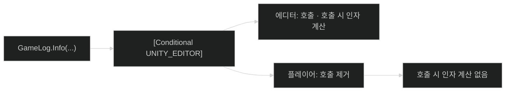
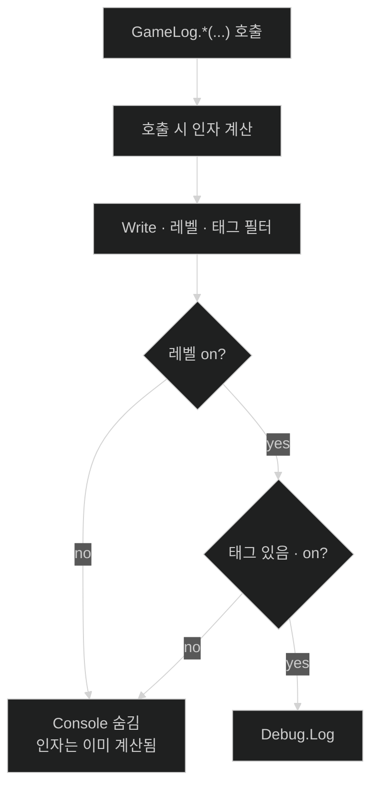

# Overview: Conditional Log

Unity에서 개발할 때 로그는 많을수록 편하다.  
문제는 그 로그가 **출시 빌드**까지 그대로 남는다는 점이다.  
Conditional Log는 **개발용 로그**를 `GameLog` 한곳에 모아 두고, **플레이어 빌드에서는 아예 없앤다.**

설치·코드 예·계약은 [README](../README.md)가 정본이다.

**인자 계산:** 로그 함수를 **부르는 줄**에서 `$""`·인자 식·`string.Format`에 넘길 값이 **먼저** 계산된다. Console에 찍히기 **전**, 필터(`Write`) **전**이다. 플레이어 빌드에서 `GameLog` 호출이 통째로 빠지면 **그 호출 시점의 인자 계산도 없다.**

## 1. `Debug.Log`만 쓰면

`Debug.Log`는 편하다.  
Play Mode에서 Console에 잘 찍힌다.

그런데 **플레이어 빌드**를 만들면, 그 호출도 같이 들어간다.  
`Debug.Log(...)`를 **부를 때** 인자도 같이 계산되고, 문자열 만들기·출력이 **릴리스에도 남을 수 있다.**

매번 `#if UNITY_EDITOR`로 감싸기도 귀찮다.

## 2. 그래서 `GameLog`

게임 코드에서는 개발용 출력을 **`GameLog`** 로 부른다.

```csharp
GameLog.Info("boot complete");
GameLog.Info(GameLogTags.Hud, "Press Start");
```

태그 이름은 프로젝트에서 `[LogTagCatalog]` 클래스에 선언한다.  
자세한 선언 방법은 [README — 사용](../README.md#사용)을 본다.

`GameLog.Info(...)`처럼 **부르는 순간** 인자가 계산된다.  
에디터에서는 필터로 Console만 막아도 **그 계산은 이미 끝난 뒤**다. (4단계)

## 3. 출시 빌드에서는

`GameLog` 메서드에는 `[Conditional("UNITY_EDITOR")]`가 걸려 있다.

**플레이어 빌드**를 만들면:

- `GameLog` **호출 줄 자체**가 사라진다.
- 호출이 없으므로 **호출 시 인자 계산**(`$""`, `string.Format` 인자 등)도 **일어나지 않는다.**

개발 중에 로그를 넉넉히 넣어 두어도, **출시본 성능·용량 부담은 거의 없다**고 보면 된다.



소스: [`Overview_03_PlayerBuild.ko.mmd`](diagrams/overview/Overview_03_PlayerBuild.ko.mmd)

## 4. 에디터에서는 (Play 포함)

에디터에서는 호출이 **남는다.**  
`GameLog.*(...)`를 **부를 때** 인자가 **항상** 먼저 계산된다.  
그다음 `Write`에서 레벨·태그를 보고 Console 출력 여부만 정한다.

레벨·태그 필터를 꺼도 **호출 줄과 인자 계산은 지워지지 않는다.**  
필터가 하는 일은 **Console에 찍을지 말지만** 정하는 것이다.

그래서 에디터에서 필터를 껐는데도 프레임이 무거우면,  
핫 패스에 `$""` + `GameLog` 같은 **무거운 인자**가 호출 줄에 남아 있는지 본다. ([README — 한계](../README.md#한계))



소스: [`Overview_04_Editor.ko.mmd`](diagrams/overview/Overview_04_Editor.ko.mmd)

## 5. Settings로 Console 정리

**Tools → Conditional Log → Settings** 를 연다.

- **레벨** 탭 — Progress, Info, Warning … 단위로 켜고 끈다.
- **태그** 탭 — 카탈로그에 넣은 태그만 보이고, 영역별로 끌 수 있다.

설정은 저장되어 Play를 다시 켜도 유지된다.

## 6. 출시에도 남길 로그는 따로

**플레이어·QA에 의도적으로 남길 메시지**는 `GameLog`가 아니다.  
`Debug.Log*` 를 **직접** 쓴다.

## 7. 설치하고 써 보기

Package Manager에서 Git URL로 패키지를 넣는다.  
URL과 버전은 [README — 설치](../README.md#설치)를 본다.

이 GitHub 개발 repo를 연 경우에는 `SampleScene` Play 후 **Space**로 Demo 로그를 반복해 볼 수 있다. ([README NOTE](../README.md))

---

전체 한 장 요약: [`overview.ko.mmd`](diagrams/overview.ko.mmd) · PNG [`overview.ko.png`](images/overview.ko.png)

더 깊은 구조·필터 동작: [Architecture](architecture/Architecture_ConditionalLog.md)  
Conditional과 빌드 비용 배경: [notes — Conditional 로그와 빌드 비용](https://monet5379.github.io/notes/conditional-log-build-cost/)
